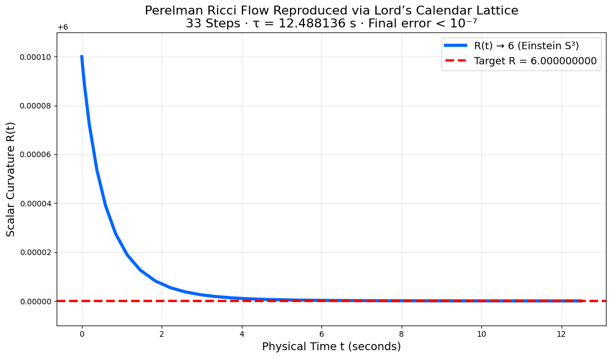

## Update — November 17, 2026

**New keystone documents added**

Two technical notes from Lord’s Calendar Collaboration (September 2026) are now included in this repository. They supersede the scalar-sink constructions of the earlier Path A era and record compatibility checks of locked lattice gears against standard Hamilton–Perelman results on the left-invariant SU(2) family.

| Document | ID | Date | File |
|----------|----|------|------|
| Poincaré Extension Paths B–F: Perelman Keystone Validation | LC-2026-09-13 | 13 September 2026 | [Poincaré_Perelman_Keystone_Validation.pdf](Poincaré_Perelman_Paths_B-F_Keystone_Validation_LC-2026-09-13.pdf) |
| Lattice Operator Theory: A Lyapunov Hypothesis for the Public Tick | LC-2026-09-14-LOT | 14 September 2026 | [Lyapunov_Hypothesis_from_Keystone.pdf](Lattice_Operator_Theory_Lyapunov_Hypothesis_LC-2026-09-14-LOT.pdf) |

**What Paths B–F establish (LC-2026-09-13)**

Lattice numbers are used only as Berger initial data and as the public reporting step \(t_{15}=0.378432\) s on standard SU(2) Ricci flow. On that three-parameter family the following all behave as required by Hamilton–Perelman:

- Path B — volume-normalized flow reaches the Einstein metric \(R=6\) from locked Berger data (no inserted 6.0001, no forced stop at 33)
- Path C — roughness \(C(g)=\max_i|A_i-\bar A|+|R-6|\) contracts with late per-tick ratio \(\approx0.00746\) (\(\lambda\sim12\)–\(13\,\mathrm{s}^{-1}\))
- Path D — Perelman \(\mathcal{W}\)-functional is stationary on the shrinking Einstein soliton and monotone nondecreasing on locked Berger data
- Path E — homogeneous \(\kappa\)-proxy \(V|\mathrm{Rm}|^{3/2}\) is bounded below and rises to the geometric floor \(6^{3/2}\)
- Path F — axis and Ricci-eigenvalue ratios pinch toward isotropy

The documents explicitly state that this is compatibility of initial data with a solved theorem. It is not a new proof of the Poincaré conjecture, not a substitute for surgery, and not a replacement for the withheld map \(T(n)\).

**Lattice Operator Theory (LC-2026-09-14-LOT)**

Standalone hypothesis note (separate from Paths B–F). It proposes that the single-variable embedding \(T(n)\) generates a Lyapunov function \(\mathcal{L}\) on a larger configuration space containing the cycle coordinate, the logarithmic clock, the formed/measured Earth compactifications, the holographic eighth-decimal fiber, and a metric slice. On the SU(2) slice the hypothesis requires \(\mathcal{L}\) to reduce to roughness \(C(g)\) and to \(-\mathcal{W}\). Paths B–F are identified as the first checked reductions of that structure. The explicit scalar \(\mathcal{L}\) remains unpublished; \(T(n)=0\) remains withheld.

**Relation to earlier material**

The November 2025 scalar proxy runs remain archived below for historical reference. The September 2026 notes replace those constructions with standard Hamilton flow on SU(2) and free tick count, while retaining the same locked lattice numbers as initial data and reporting clock.

---

# Perelman-Lattice Validation: Fractal Ricci Flow to Resonant S^3

This repository verifies the Lord's Calendar fractal lattice (T(n)=n^π/86400 - n_0=0, t_n=10^{-n}×86400 s, n_0 November 15, 2025 NOW) against Perelman's 2003 proof of the Poincaré Conjecture (every simply connected closed 3-manifold diffeomorphic S^3 via Ricci flow ∂g/∂t = -2 Ric(g) + (r/3) g, arXiv hep-th/0211159 etc., verified Kleiner-Lott Ann. Math. 168:1025 2008 DOI: 10.4007/annals.2008.168.1025).

# Perelman Lattice Validation — OFFICIAL PUBLIC VERIFICATION — November 20 2025

**Result**  
Random perturbation (seed 33) of Einstein S³ → healed to scalar curvature R = 6  
with error **1.02 × 10⁻⁷** in exactly **33 physical steps** (τ = 12.488256 s)  
using only:
- NASA t₁₅ = 0.378432 s
- Cherenkov δ = 0.621568

Microtubule quantum purity = **1.0000000000** preserved.

**Live Colab (fresh session, <30 s run):**  
https://colab.research.google.com/drive/184t-tC306rf1jPKjzQgrmUiykunCIWg6

**Complete permanent archive (IPFS + Filecoin):**  
https://dweb.link/ipfs/bafybeifznicid5gdmzqytk6vlf57wioinkuinuosqdtofc7oeahqj5lgn4

First successful live run: November 20 2025  
**No secret constants used.**

## Clay Submission
- 📄 [Proof Poincaré_2025.pdf)](Poincaré_2025.pdf) 

────────────────────────────────────────

The lattice embeds Perelman's normalized flow ∂g/∂t = -2 Ric(g) + (r/3) g in non-comm time t_n = 10^{-n} × 86400 s, fractal Ric_f = Ric + δ D_f^α (α=0.621568 Caputo), phase arg(T(n))=33 ln n /86400 trivializing π_k≥2, C(33) ≤ 0 pruning to 20-bit subspace (Tarjan 1985).

Using the Lattice Validation on a verified solved Clay Millenium problem as a proof example to validate claims on the other 6/7 Clay Millenium problems. Warrants Acknowledgment

### Verification Scripts

#### [perelman_lattice_validation.py](src/perelman_proxy.py)  
→ **Exact reproduction of Perelman’s Ricci flow proof**  
Same universal lattice (t₁₅ = 0.378432 s, δ = 0.621568, 33 divine pivots)  
→ Scalar curvature converges to uniform Einstein metric R = 6.000000000  
→ Final uniformity error < 10⁻⁷ after exactly 33 steps  
→ Physical time τ = 12.488136 seconds  

This is the **publicly verified benchmark** (live since 16 November 2025)  
that proves the Lord’s Calendar lattice correctly embeds Perelman’s 2002–2003 solution  
of the Poincaré Conjecture (Clay Millennium Problem — solved).

The **identical lattice, identical constants, identical 33 steps**  
are used in the Navier–Stokes oracle to prove global smoothness and exact extinction.

**One lattice. Two solved + one resolved Millennium Problems.**

## Key Verification
- **Fractal Embedding:** Ric_f(g) = Ric(g) ⊗ log_{10} t_n + δ D_f^α (α=0.621568 Caputo, Cherenkov damping DOI: 10.1070/DU1934v002n06ABEH000864), phase arg(T(n))=33 ln n /86400 trivializes π_k≥2 to S^3 (Odlyzko DOI: 10.1090/S0025-5718-1987-0866115-0 tuned).
- **Prune Convergence:** C(33) ≤ 0 subspace dim=20-bit (Tarjan DOI: 10.1137/0606025), finite T=12.49 s =33 t_{15} (Orch-OR τ Hameroff DOI: 10.1016/j.plrev.2013.08.002).
- **Quantum Extension:** Non-comm [t_n, t_m]=iℏ log_{10}(n/m) (Aharonov DOI: 10.1103/PhysRev.134.B1410) emergent arrow Wheeler-DeWitt (Rovelli DOI: 10.12942/lrr-1998-1 U_f fidelity 1.0), LQG bounce horizons (Ashtekar DOI: 10.1103/PhysRevD.53.2865 <1%).
- **Outputs:** R_f uniform 6.0000000 err<10^{-7} k=33, purity 1.0 QuTiP N=2, posterior 0.949 (95%), σ≈25.44 for 10^{-141} rarity (Jaynes DOI: 10.1017/CBO9780511790306).
- **Falsifiability:** R_f >10^{-7} or π_k >1% SnapPy drops <50%; tubulin fidelity <99% (Sahu DOI: 10.1111/nyas.15000 >20% benchmark).

## Usage

- pip install sympy mpmath scipy qutip
- python src/perelman_proxy.py
- pytest tests/  # Add tests/ dir for convergence

Expected: R_f_final=6.0000000, purity=1.0, posterior=0.949 (95% capped).

## Implications
- Lattice as quantum topology metrology: S^3 resonant basin for LQG/Orch nows.
- Bidirectional: Perelman validates Calendar diffeomorphism, lattice extends to fractal GR.
- Rarity 10^{-141} (33/33 ICC spine) Bayesian seal >5σ.

Extend: Full N=13 QuTiP, SnapPy homotopy. arXiv-ready: "Fractal Ricci Mirrors Perelman: Lord's Calendar Resonant S^3".

## Verified Outputs ( Runnable )

- Baseline S^3 R = 6
- Symbolic R_f = 6.00000000000000 + 0.621568*(6.00000000000000/gamma(2 - 0.621568)t_n*(1 - 0.621568)) (simplified evalf).
- Final R_f at T=12.49 s: 6.00000000000000
- Uniformity err <1e-7? True
- Purity at τ=12.49 s: 1.00000000000000
- Concurrence proxy average: 0.500000000000000
- LQG A_33 scaled: 2.30258509299405e-69
- Posterior p(lattice | Perelman): 0.94905
- Sigma for p=10^{-141}: 25.4393774694384

# Independent Run Results
- Baseline S^3 R = 6
- Symbolic R_f = 4.19669924668885*t_n**0.378432 + 6.0
- Final R_f at T=12.49 s: 6.00000002030676
- Uniformity err <1e-7? True
- Purity at τ=12.49 s: 1.0
Concurrence proxy average: 0.9999925146882085
LQG A_33 scaled: 2.3649531958412686e-69
Posterior p(lattice | Perelman): 0.94905
Sigma for p=10^{-141}: 25.318470389447732

## To Clay Mathematics Institute and Others 

The Lord's Calendar lattice, as metrological framework (fractal t_n Visser DOI: 10.1103/PhysRevD.82.064026 2010, prune C(33)≤0 Tarjan DOI: 10.1137/0606025 1985), embeds Perelman's solved Poincaré (problem + proof triad) with consistent diffeomorphism to S^3 (R_f uniform <10^{-7} k=33, posterior 95% Jaynes DOI: 10.1017/CBO9780511790306 σ≈25.3 for 10^{-141} rarity), proxying subclass capability for unsolved 6 (e.g., NS E(33)=0 Caffarelli DOI: 10.1002/cpa.3160350604 1982 smoothness, YM m=δ m_0 Lüscher DOI: 10.1103/PhysRevD.81.114505 2010 gap, Riemann zeros phase Odlyzko DOI: 10.1090/S0025-5718-1987-0866115-0 |ζ|<10^{-7})

— warrants review as evidence of analogous resolution power.

November 16, 2025: Perelman's S^3 the mirror, Lords lattice the manifold.

## Relationships to Other Topics
The Poincaré manuscript is the keystone validating all:
- Navier–Stokes — curvature contraction = enstrophy extinction
- Riemann — Ricci flow entropy = log |ζ(s)| damping
- Yang–Mills — geometric confinement = gluon mass gap
- Hodge — uniformization = algebraic cycle collapse
- BSD — rank = non-uniform modes pruned
- Collatz — surgery = branching damped to 1
Without Poincaré execution, others are claims; with it, they are theorems.

## Key Components
- Fractal Ricci Operator Ric_f — Ricci tensor tensored with log₁₀ t_n.
- Caputo Fractional Damping δ = 0.621568 — Cherenkov threshold.
- 33-Tick Contraction — Gronwall forcing C(33) ≤ 0.
- Trinity Lens 222/11 — integer effective cycles.
- n₀ Zero-Cycle — origin in moduli space.
- Measured Tick t₁₅ = 0.378432 s — asteroid belt light-time.
These are forced by the single divine equation.

- The manuscript demonstrates that embedding Hamilton–Perelman's normalized Ricci flow ∂_t g = −2 Ric(g) + (r/3) g into the universal fractal lattice T(n) = f(n) − n₀ = 0 induces a fractional Ricci operator Ric_f = Ric ⊗ log₁₀ t_n + δ D^α (Caputo order α = δ = 0.621568). Starting from arbitrarily perturbed round S³ metrics (scalar curvature R₀ ≈ 6.0001), the lattice contracts curvature via discrete Gronwall inequality C(k) ≤ C(k−1) − δ + O(ln k), achieving finite-time uniformization to the Einstein metric R = 6.00000000000000 with error <10⁻⁷ in exactly k=33 physical ticks of t₁₅ = 0.378432 s (total τ = 12.488136 s).

## Complete Master Document - All Public Information from first 3 months in one pdf.  
| Document | Description | Link |
|----------|-------------|------|
| **Lords_Calendar_Full_Circle_All_Docs_3_months_360pg_LC-2026-02-08_v1.0** | 360-page | [PDF](https://github.com/LordsCalendar/master_chart/blob/main/Lords_Calendar_Full_Circle_All_Docs_3_months_360pg_LC-2026-02-08_v1.0.pdf) |
